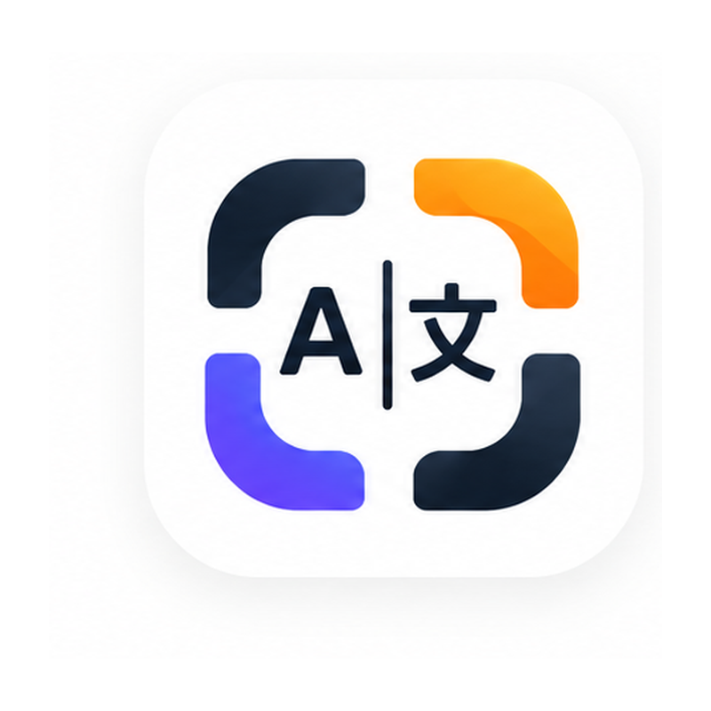

<p align="center">
  
</p>

<h1 align="center">Lens Viva</h1>

<p align="center">
  Read the world through your camera.
  <br />
  Live text recognition, readable translation overlays, and optional contextual AI translation.
</p>

<p align="center">
  <a href="#quick-start">Quick start</a> ·
  <a href="#android">Android</a> ·
  <a href="#online-translation">Online translation</a> ·
  <a href="docs/ARCHITECTURE.md">Architecture</a> ·
  <a href="CONTRIBUTING.md">Contributing</a>
</p>

---

Lens Viva is a camera translation app built with Angular, Ionic, and Capacitor. Point your camera at a sign, a menu, or a paragraph to recognize text and display translations over the live preview. Freeze the frame to read at your own pace and tap a translation to inspect the original text.

Android uses a custom Kotlin camera engine with Google ML Kit for on-device recognition and offline translation. The browser implementation uses Tesseract.js for recognition and the browser's Translator API when available. An optional Node.js server adds Gemini translation using complete phrases and scene context.

**Project status:** version **0.2.1**, in active development. Android is the native platform included in this repository; browser support depends on available camera and translation APIs. Online translation requires your own server configuration and provider credentials.

## Features

Try the interactive examples at **http://localhost:4200/demo** after starting the development server. The demo reuses the app's overlay renderer with clearly labeled sample results; it needs no camera, provider account, or language downloads.

- **Live camera translation:** tracked text regions keep overlays aligned as the scene changes.
- **Readable overlays:** translations stay on a single line without splitting words. Dense scenes switch to a scrollable reading panel.
- **Phrase-aware processing:** nearby, aligned OCR lines are grouped into paragraphs to preserve meaning while keeping separate columns apart.
- **Local English OCR repair:** a bundled spelling dictionary repairs uniquely recoverable letter errors before local translation, while preserving the original OCR for inspection. Ambiguous words remain unchanged.
- **Contextual online translation:** the optional Gemini server receives the requested text and scene context and can flag ambiguous OCR instead of returning a guessed translation.
- **Offline Android translation:** downloadable ML Kit language models support use without a connection after setup.
- **Multiscript recognition:** Latin, Japanese, Chinese, Korean, and Devanagari recognizers are included in the Android app.
- **Independent language choices:** select the interface language, source language, and translation destination separately.
- **Menu terminology:** an English-to-Portuguese glossary handles recognized menu headings during offline translation.
- **Local preferences and history:** customize text size and recognition settings, and optionally keep translation history on the device.

## Quick start

### Requirements

| Tool                | Requirement                                                                                                |
| ------------------- | ---------------------------------------------------------------------------------------------------------- |
| Node.js             | `24.18.0` is pinned in [`.nvmrc`](.nvmrc); supported ranges are declared in [`package.json`](package.json) |
| npm                 | The project declares `npm@11.16.0`                                                                         |
| Browser             | Camera access through `localhost` or HTTPS                                                                 |
| Android development | JDK 21, Android Studio, and Android SDK 36                                                                 |

From the repository root:

```sh
npm ci
npm start
```

Open **http://localhost:4200** and allow camera access. No provider API key is required to start the app or run its tests.

Browser translation availability varies by browser, device, and language pair. If the browser does not expose a compatible Translator API, configure the online translation server to translate recognized text. Tesseract language data may require a download on first use.

### Using the app

1. Open the camera and tap the language card.
2. Choose the source language and translation destination. Select the source explicitly when reading Japanese or another non-Latin script.
3. For offline Android use, download the required translation models from the language screen. With an online server configured and an internet connection, local translation models are not required.
4. Point the camera at clearly visible text. Freeze the frame when you need more time to read.
5. Tap an overlay to view its original text. In dense scenes, scroll the reading panel horizontally or vertically.

## Android

The application ID is `com.oaxis.lensviva`. The current Android configuration targets SDK **36** and supports Android **7.0 / API 24** and later.

Build the web app and synchronize Capacitor:

```sh
npm run android:sync
npm run android:open
```

Use Android Studio to select a device and run the app, or build from the command line:

```sh
cd android
```

**macOS / Linux:**

```sh
bash ./gradlew :app:testDebugUnitTest :app:assembleDebug
```

**Windows PowerShell:**

```powershell
.\gradlew.bat :app:testDebugUnitTest :app:assembleDebug
```

The debug APK is generated at:

```text
android/app/build/outputs/apk/debug/app-debug.apk
```

Debug APKs are intended for development. Build outputs and locally copied APKs are excluded from Git. See the [development guide](docs/DEVELOPMENT.md) for SDK setup, Windows troubleshooting, and release preparation.

## Online translation

The optional server in [`server/`](server/) uses **Gemini**. An OpenAI adapter is not currently implemented.

```text
Camera → on-device OCR → phrase and scene context → your server → Gemini
```

Camera images stay on the device. In online mode, recognized text and scene context are sent to your configured server and then to the provider.

To enable it:

1. Copy [`server/.env.example`](server/.env.example) to `server/.env`.
2. Set `GEMINI_API_KEY`, choose `GEMINI_MODEL`, and generate a separate `CLIENT_TOKEN`.
3. Run `npm run server:start` or deploy the server behind HTTPS.
4. In **Settings → Online translation → Configure server**, enter the full `/translate` URL and the client token.

For browser development on the same computer, use `http://127.0.0.1:8787/translate`. A phone needs an HTTPS endpoint it can reach; `localhost` on the phone refers to the phone itself.

The provider key belongs only on the server. The app's token field takes `CLIENT_TOKEN`, never `GEMINI_API_KEY`. No credentials or public translation endpoint are shipped with the app.

Without a configured online server, Android continues to use its offline translation engine. When the device is offline, the relevant local models are required. A server failure is reported as unavailable; it does not automatically trigger an offline translation retry.

See the [server guide](server/README.md) for environment variables, the HTTP contract, deployment behavior, and request limits. Provider and hosting usage depend on the accounts you configure.

## Language support

Recognition, translation, and interface localization have different coverage:

| Capability           | Current coverage                                                           |
| -------------------- | -------------------------------------------------------------------------- |
| Interface            | English, Portuguese, Spanish, French, German, Italian, Japanese            |
| Camera recognition   | Selected Latin-script languages, Japanese, Chinese, Korean, Hindi, Marathi |
| Translation selector | 59 language codes, listed below                                            |

<details>
<summary>Translation language codes</summary>

```text
 af ar be bg bn ca cs cy da de el en eo es et fa fi fr ga gl
 gu he hi hr ht hu id is it ja ka kn ko lt lv mk mr ms mt nl
 no pl pt ro ru sk sl sq sv sw ta te th tl tr uk ur vi zh
```

</details>

The translation selector's coverage does not imply OCR support for every script. On Android, automatic source selection uses a recognizer associated with the target language and then identifies the recognized text's language; it does not scan every script simultaneously. Choose the source explicitly to select the appropriate recognizer. Browser and provider language availability can differ.

The source of truth is [`constants.ts`](src/app/shared/utils/constants/constants.ts); interface translations live in [`public/i18n/`](public/i18n/).

## How it works

1. The platform engine captures camera frames and recognizes text locally.
2. The recognition coordinator filters noise, tracks regions, and groups related lines.
   It also joins adjacent words reported as separate OCR blocks. Translation always uses phrase/paragraph grouping, including installations with an older line-mode preference.
3. The translation queue checks its cache and selects online translation or the platform's local translator.
4. The overlay layer fits readable text to the preview, switching to a reading panel when needed.
   Translations stay horizontal even when the source is rotated.
5. Preferences and optional history are stored locally through Capacitor Preferences.

See [Architecture](docs/ARCHITECTURE.md) for the data flow and the main extension points.

## Technology

| Layer                   | Implementation                             |
| ----------------------- | ------------------------------------------ |
| Application             | Angular 22, TypeScript 6, Ionic 9, SCSS    |
| Native bridge           | Capacitor 8 and a custom LensEngine plugin |
| Android engine          | Kotlin, CameraX, Google ML Kit             |
| Browser recognition     | Tesseract.js 7                             |
| Optional online service | Node.js HTTP server and Gemini REST API    |
| Localization            | ngx-translate with seven locale files      |
| Tests                   | Vitest, Node.js test runner, JUnit         |

## Development commands

Run these commands from the repository root:

| Command                     | Purpose                                                    |
| --------------------------- | ---------------------------------------------------------- |
| `npm start`                 | Start the development server                               |
| `npm run build`             | Create a production web build in `dist/lens-viva/browser/` |
| `npm run watch`             | Rebuild the web app in development mode                    |
| `npm test -- --watch=false` | Run the application test suite once                        |
| `npm run test:coverage`     | Run unit tests and generate text, HTML, and JSON coverage  |
| `npm run server:test`       | Run server tests with a simulated provider                 |
| `npm run server:start`      | Start the optional server using `server/.env`              |
| `npm run android:sync`      | Build the web app and synchronize Android                  |
| `npm run android:open`      | Open the Android project in Android Studio                 |
| `npm run android:run`       | Build and run on an Android device or emulator             |

The [GitHub Actions workflow](.github/workflows/ci.yml) runs application tests, server tests, and the production web build. Native unit tests run separately through Gradle. Automated server tests do not require credentials or call a live provider; they do not establish real-world translation quality.

## Repository layout

```text
.
├── .github/                 # CI and pull request template
├── android/                 # Native project, Kotlin engine, and JUnit tests
├── assets/                  # Source artwork for icons and splash screens
├── docs/                    # Architecture and development guides
├── public/i18n/             # Interface translation dictionaries
├── server/                  # Optional Gemini translation server and tests
├── src/
│   ├── app/
│   │   ├── pages/           # Camera, languages, settings, history, and terms
│   │   ├── services/        # Recognition, translation, session, and storage
│   │   └── shared/          # Overlay components, models, and utilities
│   ├── assets/              # Runtime brand assets
│   └── environments/        # Build environment and app version
├── CONTRIBUTING.md
├── capacitor.config.ts
├── package.json
└── README.md
```

Dependencies, caches, build output, APKs, logs, signing material, and local environment files are ignored. Commit the lockfile, Android source, and Gradle wrapper so another developer can reproduce the project.

## Documentation and contributions

- [Development guide](docs/DEVELOPMENT.md): setup, verification, Android troubleshooting, and releases.
- [Architecture](docs/ARCHITECTURE.md): platform engines, recognition, translation, and rendering.
- [Translation server](server/README.md): configuration, deployment, and API contract.
- [Contributing](CONTRIBUTING.md): focused changes, translation updates, and validation expectations.
- [Engineering decisions](docs/decisions/README.md): constraints, alternatives, consequences, and regression evidence.
- [Validation guide](docs/VALIDATION.md): automated checks, browser review, and remaining real-device/provider checks.

## License

This repository does not currently include a project license. Redistribution and reuse permissions must be agreed with the project owner. Third-party dependencies retain their respective licenses.
