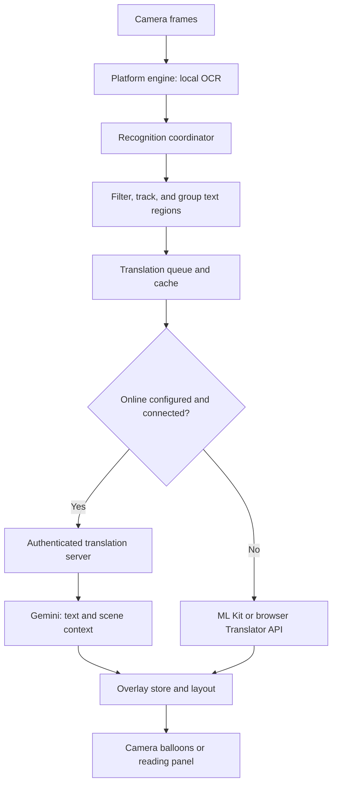

# Architecture

Lens Viva separates the camera engine from recognition coordination, translation, and presentation. Angular owns the application interface and orchestration. A shared Capacitor plugin contract connects it to the Android implementation or the browser implementation.

## Processing flow

The diagram describes translation routing. Online availability is based on configuration and the device's connectivity signal, not a server health check. An unreachable configured server produces an unavailable notice.

## Platform engines

| Platform | Camera and recognition                                      | Local translation                                  |
| -------- | ----------------------------------------------------------- | -------------------------------------------------- |
| Android  | CameraX and ML Kit, exposed by the Kotlin LensEngine plugin | ML Kit translation with downloaded language models |
| Browser  | MediaDevices camera access and a Tesseract.js worker        | Browser Translator API, when supported             |

The plugin interface is defined in [`lens-engine.plugin.ts`](../src/app/services/lens-engine/lens-engine.plugin.ts). The web implementation is [`lens-engine-web.ts`](../src/app/services/lens-engine/lens-engine-web.ts). Android code lives in [`android/app/src/main/java/com/oaxis/lensviva/`](../android/app/src/main/java/com/oaxis/lensviva/).

Android includes separate recognizers for Latin, Japanese, Chinese, Korean, and Devanagari. Selecting a recognition source chooses the appropriate script recognizer. Automatic source selection uses the destination language to choose a recognizer; language identification then operates on recognized text.

## Recognition coordination

[`RecognitionCoordinatorService`](../src/app/services/recognition-coordinator/recognition-coordinator.service.ts) coordinates frame events, language selection, region normalization, tracking, and translation requests.

- Recognition filters suppress small, low-confidence, or partially visible noise.
- Tracking matches text and geometry across frames, smooths movement, and expires stale regions.
- Paragraph grouping joins nearby aligned blocks without terminal sentence punctuation. Distinct columns and unrelated text remain separate.
- Menu detection uses multiple distinct known headings. In menu scenes, individual labels are preserved.
- Online processing uses paragraph granularity and scene context. Live text must stabilize before a request is queued; frozen frames can be processed immediately.

The grouping, geometry, tracking, menu, and normalization policies are utilities under [`src/app/shared/utils/`](../src/app/shared/utils/), with colocated unit tests.

## Translation

[`TranslationQueueService`](../src/app/services/translation-queue/translation-queue.service.ts) limits concurrency and coordinates cached results. Online cache keys distinguish endpoint and context; local menu terminology has a separate context from general translation.

[`OnlineTranslationService`](../src/app/services/online-translation/online-translation.service.ts) sends text, context, and language codes to the configured endpoint. It accepts HTTPS, with HTTP allowed only for loopback development. It reports unavailable requests and uncertain results through the interface.

The Node.js server validates access and input before calling the Gemini adapter. Its prompt treats OCR content as untrusted data, asks for complete-phrase translation, and requests an uncertainty flag when the intended text is ambiguous. This is a model instruction, not a guarantee that every OCR error or mistranslation will be detected.

[`LanguageModelService`](../src/app/services/language-model/language-model.service.ts) manages local model availability. Model checks are skipped when online translation is configured and the device reports a connection. Offline Android translation still requires the corresponding downloaded models.

## Rendering

[`OverlayLayerComponent`](../src/app/shared/components/overlay-layer/overlay-layer.component.ts) converts normalized geometry into preview coordinates, fits single-line translations, and checks the width of rendered text. It uses a scrollable reading panel when balloons would overlap, become unreadable, or cover too much of the preview.

Block translations use a compact rendered line height rather than covering the full original paragraph. Original OCR text remains available when the user opens a translation.

## Storage and data boundaries

- Preferences and optional translation history use Capacitor Preferences on the device.
- Translation caches are managed by the application services.
- Camera images remain local in the current online translation flow.
- Online requests contain recognized text and scene context. The configured server forwards this data to Gemini.
- Provider credentials are server environment variables. The app stores a separate client access token in its preferences.

## Extending the project

| Change                             | Primary location                                              |
| ---------------------------------- | ------------------------------------------------------------- |
| Add or revise a screen             | `src/app/pages/`                                              |
| Adjust overlay layout              | `src/app/shared/components/overlay-layer/`                    |
| Change phrase or tracking policies | `src/app/shared/utils/`                                       |
| Add interface text                 | All seven files in `public/i18n/`                             |
| Change Android recognition         | Kotlin engine and `android/app/build.gradle`                  |
| Add an online provider             | Server adapter implementing the existing translation contract |

Keep the HTTP contract stable when adding a provider so the app does not need provider-specific credentials or request logic. See the [server guide](../server/README.md) for that contract and the [development guide](DEVELOPMENT.md) for verification.
